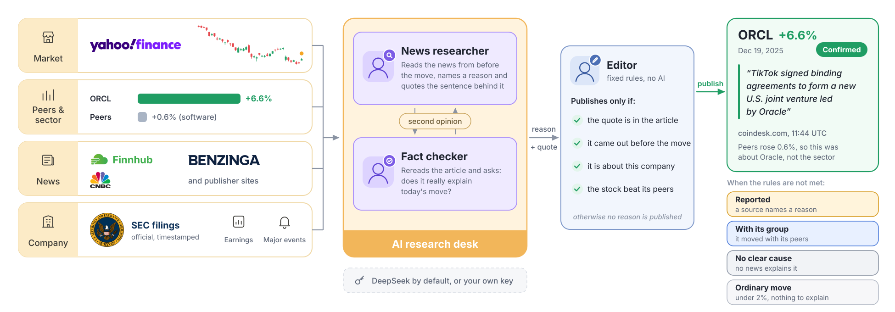

<h1 align="center">Catalyst</h1>

<p align="center">
  <b>Why did this stock move? Catalyst answers with the sentence that explains it.</b>
</p>

<p align="center">
  <a href="https://github.com/YiannisChen/Catalyst/actions/workflows/ci.yml"></a>
  <a href="LICENSE"></a>
  
  
</p>

<p align="center">
  <a href="https://catalyst.yiannischen.dev"><b>Live demo</b></a> ·
  <a href="#quickstart">Quickstart</a> ·
  <a href="#how-it-works">How it works</a> ·
  <a href="#evaluation">Evaluation</a> ·
  <a href="#roadmap">Roadmap</a>
</p>

Catalyst is an agent that explains large stock moves. Pick a ticker and a trading
day: it measures the move against the market, the sector and the company's peers,
reads the news and SEC filings published before it, and returns the cause in the
source's own words, with the publisher and the time it appeared. When nothing in
the record explains the move, it says so.


<sub>One Microsoft session: market context, evidence review, and a confirmed
cause with its source sentence highlighted.</sub>

**Try it:** open the [live demo](https://catalyst.yiannischen.dev) and replay a
featured case such as *Oracle, 2025-12-19*, or bring your own model key to analyse
any covered day.

## What you get

Every analysis ends in one of five results:

| Result | Meaning |
|---|---|
| **Confirmed** | A source published before the move states the cause, and a second model check agrees it explains this move |
| **Reported** | A source states a reason that did not pass the second check; shown with its quote |
| **With its group** | The stock moved with its sector or peers, so no company-specific cause is needed |
| **No clear cause** | Nothing published before the move explains it |
| **Ordinary move** | Under 2% from the previous close |

Each answer comes with the move against its sector and peers, the opening gap,
the quoted sentence with its publisher and time, and the full list of news that
was read.

## How it works



One analysis runs like a small newsroom:

1. **Market facts.** Returns for the stock, its sector ETF, its peers and the
   relevant commodity, the opening gap, and how unusual the volume was.
2. **Retrieval.** Full-text search (SQLite FTS5) over news and SEC filings
   published before the move, kept to items about the company or its group.
3. **News researcher (model).** One call reads the evidence and proposes causes,
   each tied to sentences it selects from a source.
4. **Fact checker (model).** A second, short call checks that those sentences
   explain *this* stock's move in *this* session.
5. **Editor (code).** Fixed rules publish a cause only when the quote is verbatim
   in its source, the source predates the move, it is about this company, and the
   stock moved more than its peers.
6. **Answer.** The result, facts and quotes are rendered from stored data, so
   every replay shows exactly what the run saw.

Models propose; code decides. The model never writes the published sentence: it
points at one, and the editor checks it.

Under the hood, a React workbench talks to a FastAPI service that admits each run
under per-run cost and time budgets and streams progress over server-sent events.
The attribution graph runs on LangGraph. A daily pipeline keeps prices, filings,
headlines and the search index current for 102 large-cap U.S. stocks. See
[docs/architecture.md](docs/architecture.md) for components and package boundaries.

## Data

| Source | Used for |
|---|---|
| Yahoo Finance (yfinance) | Daily prices and volume for stocks, sector ETFs, market and commodity proxies |
| SEC EDGAR | 8-K filings and earnings releases, timed by SEC acceptance |
| Finnhub, Polygon | Company headline discovery |
| Alpaca news (Benzinga wire), CNBC, publisher pages | Article text |

All sources are free or free-tier. The search corpus (177k documents) and the
runtime stores are built by the pipeline and are not part of this repository; the
[data card](docs/data/data-card.md) describes coverage and timing.

## Quickstart

### Try the interface without data or keys

Mock mode serves bundled sample responses, so it needs neither the corpus nor
provider credentials.

```bash
git clone https://github.com/YiannisChen/Catalyst.git
cd Catalyst/apps/web && npm ci && cd ../..
make dev-mock
```

Open <http://localhost:5173>.

### Run the real stack

Requires Python 3.11+, Node 22, a model API key (DeepSeek by default, or any
supported provider), and a populated corpus and stores.

```bash
python -m venv .venv && source .venv/bin/activate
make install
cp .env.example .env        # set store paths and your model key
PYTHONPATH=packages/data:packages/agents:packages/api \
  uvicorn catalyst_app.main:app --app-dir packages/api --host 127.0.0.1 --port 8000
make web                    # in a second terminal
```

`GET http://127.0.0.1:8000/api/health` reports `ready` once the stores are found.
Settings are documented in [`.env.example`](.env.example); deployment is covered
in [deploy/README.md](deploy/README.md).

## Evaluation

The numbers below come from the research phase, measured on earlier versions of
the pipeline against hand-labelled sessions.

**Held-out results** (36, 36 and 60 sessions; three runs per case; case-clustered
95% intervals):

| Metric | Set A | Set B | Set C |
|---|---|---|---|
| Agreement with the gold label | 68.5% | 68.5% | 58.3% |
| Wrong event among published causes | 22.5% | 22.4% | 29.7% |
| Correct "no clear cause" | 69.7% | 72.2% | 74.6% |

**Experiments that shaped the design:**

- **Measuring the right thing.** An early status-matching metric scored an
  always-answer baseline at 96% and Catalyst at 77%. It rewarded answering over
  being right, so it was replaced by the gold-label metrics above.
- **The fact checker.** Over 216 runs on 36 sessions, the second model check cut
  the wrong-event rate from 37.6% to 22.5% (−15.1 points, 95% CI −27.5 to −4.5).
- **Retrieval.** On a recall@8 benchmark, FTS5 (0.294) matched dense retrieval
  (0.298) and beat reranked (0.272) and hybrid (0.183) setups, so Catalyst ships
  the simpler index. Every method sat well below the 0.839 reachable ceiling, which
  puts the next gains in candidate generation rather than the retriever.

## Limitations

Catalyst covers 102 large-cap U.S. stocks and explains one trading day at a time.
Its evidence is free and free-tier news, SEC filings and daily market data, so
moves driven by paywalled reporting, options flow or intraday events it does not
see can end as "No clear cause". Moves with several drivers at once, such as a
macro shift on top of company news, are the hardest cases. Catalyst explains past
moves; it does not make trading recommendations.

## Roadmap

- **Multi-day moves.** Explain a slide or rally across days or weeks: find the key
  events, split the move into phases, and show how news and price lined up.
- **Richer market signals.** Bring intraday bars (already collected) into
  attribution to time a move against a headline, then explore options activity,
  short interest and positioning.
- **Deeper evidence.** Broader and more complete news coverage, structured
  earnings expectations and analyst revisions, and macro and rates calendars.
- **Multi-factor reasoning.** Weigh several drivers in one answer, reconcile
  conflicting explanations, and reduce both wrong causes and unnecessary "no clear
  cause" results.
- **Evaluation harness.** A reproducible harness with larger test sets, failure
  analysis, regression checks, and quality, cost and latency comparisons across
  models and graph designs.
- **Wider coverage.** More tickers and sessions, with the daily pipeline building
  the corpus and search index for each new name.

## Repository layout

```text
apps/web/         React workbench (Vite, TypeScript)
packages/api/     FastAPI service: admission, quotas, run execution, streaming
packages/agents/  attribution graph, evidence rules, model calls
packages/data/    ingestion, stores, corpus build and retrieval
contracts/        API and event schemas
deploy/           systemd units, nginx, deploy scripts
docs/             architecture, data and system cards, diagrams, demos
scripts/          development and export tools
```

## Development

```bash
make install     # Python dependencies
make test        # all test suites, one pytest process per package
make lint        # ruff baseline and import-layer contracts
make contract    # regenerate the OpenAPI contract and web client types
make web         # web app in dev mode
```

## Documents

- [Architecture](docs/architecture.md)
- [Data card](docs/data/data-card.md) and [data contract](docs/data/contract.md)
- [System card](docs/system-card.md)
- [Deploy guide](deploy/README.md)
- [Security policy](SECURITY.md) · [Contributing](CONTRIBUTING.md)

## License

MIT. See [LICENSE](LICENSE). Source logos in the framework figure belong to
their owners and identify data sources; see
[docs/diagrams/README.md](docs/diagrams/README.md).
