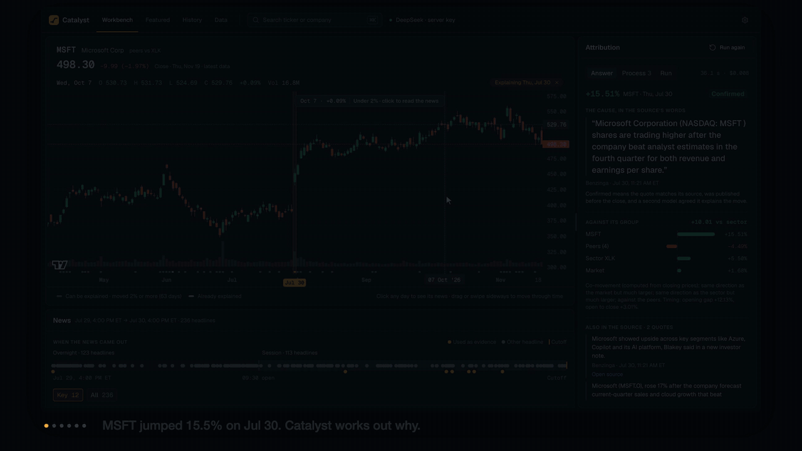
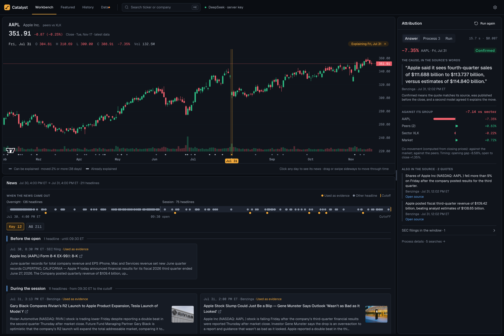
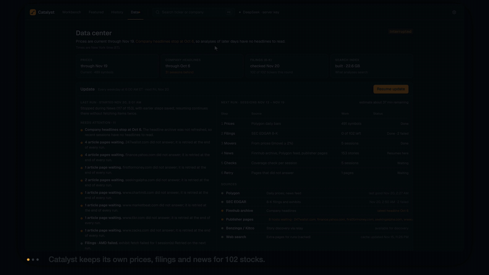

# Catalyst

[](https://github.com/YianniChen/Catalyst/actions/workflows/ci.yml)

Catalyst explains why a US large-cap stock moved on a given day. It compares the move with the market, sector, and peers, searches news and SEC filings, checks candidate explanations against source text and timing, and abstains when the evidence does not support a cause.



The analysis demo follows one MSFT session from market context through evidence review and a confirmed explanation, with the supporting source text highlighted.



| Result | Meaning |
|---|---|
| Confirmed | A verbatim quote, published before the close, that a second model agrees explains this stock's move |
| Reported | A source states a reason, but it could not be confirmed with a second check |
| With its group | The stock moved with its sector or peers; no company-specific cause is needed |
| No clear cause | Nothing in the evidence explains the move, so no cause is published |
| Ordinary move | Under 2% from the previous close; the news is readable, no cause is sought |

## How one attribution runs

```text
Market facts      returns vs SPY, sector ETF, peers, commodity proxy; opening gap   (code)
Retrieval         SQLite FTS5 over a point-in-time news/filings store, session window,
                  "is it about this company or its group" subject rule              (code)
Evidence Analyst  one LLM call: per-evidence dispositions and candidate causes,
                  each backed by sentences it selects from the evidence            (model)
Quote rules R1-R6 the sentence is in the evidence, verbatim, complete, full text,
                  published inside the session window, not about another session  (code)
Honesty gates     co-movement, subject and pre-open timing; they can only lower
                  the result to "abstain"                                          (code)
Verifier          a second short LLM call: do these quotes explain THIS stock's
                  move in THIS session? No verdict means abstain                   (model)
Answer            facts panel + quoted causes, or an abstention with a labelled
                  possible explanation and news leads; rendered by code            (code)
```

The browser submits a symbol, session date, and provider choice to the API. The API admits the run, streams progress, and composes the agents graph. The graph reads market context and session evidence, applies quote, timing, subject, and market-context checks, then lets a verifier reduce confidence or cause abstention. The API persists a trace and final view for the browser to render.

## Data

Free public sources provide daily prices, SEC 8-K filings, and news discovery and article text. Fetching respects source limits and terms. The corpus and runtime stores are generated separately and are not in this repository.

| Source | Used for |
|---|---|
| yfinance | Daily prices for stocks, sector ETFs, and market proxies |
| SEC EDGAR | 8-K filings and exhibits |
| Finnhub and Polygon free tiers | Company headline discovery |
| Public publisher pages, Benzinga archive, Kitco wire | Article text and market, sector, and commodity reporting |



The data update demo shows a daily job progressing through its collection steps and recording the run. The `catalyst-daily` job updates the supported 102-stock universe with prices, filings, and news for that day's movers. It resumes after interruption and reports partial outcomes as partial.

## Measured quality

Research-phase results used two fresh 36-case held-out sets and a later 60-case set, with three runs per case and case-clustered 95% intervals. Agreement with gold was 0.685, 0.685, and 0.583; wrong-event rates among published causes were 0.225, 0.224, and 0.297; correct abstention rates were 0.697, 0.722, and 0.746. The intervals were wide. The evaluation harness is kept outside this repository.

## Try it without data

The mock mode uses bundled sample responses and does not require the corpus or provider credentials.

```bash
make dev-mock
```

## Run the real stack

Install dependencies, then run the API and web app in separate terminals. Real analyses require configured model access and a populated corpus and stores.

```bash
make install
PYTHONPATH=packages/data:packages/agents:packages/api uvicorn catalyst_app.main:app --app-dir packages/api --host 127.0.0.1 --port 8001
make web
```

## Repository layout

```text
apps/web/         React workbench
packages/api/     HTTP API and run execution
packages/agents/  attribution graph and evidence rules
packages/data/    ingestion, stores, and retrieval
contracts/        API and event schemas
deploy/           service and deployment configuration
docs/             public project documentation and demos
scripts/          development and export tools
```

## Development

Python 3.11+ and Node 22 are used by the project. Common commands:

```bash
make install
make test
make lint
make contract
make web
```

## Documents

- [Architecture](docs/architecture.md)
- [Data card](docs/data/data-card.md)
- [System card](docs/system-card.md)
- [Deploy guide](deploy/README.md)
- [Security policy](SECURITY.md)
- [Contributing](CONTRIBUTING.md)

## License

MIT. See [LICENSE](LICENSE).
