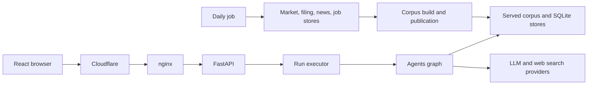

# Architecture

Catalyst explains a US large-cap stock's move from point-in-time market, news, and filing evidence. The service publishes a cause only when the evidence passes its rules; otherwise it reports an abstention.

The public results are **Confirmed**, **Reported**, **With its group**, **No clear cause**, and **Ordinary move**. A second model acts as the fact checker (the code calls it the verifier); the editor applies fixed code rules to decide what can be published. The daily universe contains 102 large-cap U.S. stocks.

## Components and package boundaries

- `apps/web` is the React/Vite browser application. It uses the generated API types in `apps/web/src/api/schema.d.ts` and the typed client in `apps/web/src/api`.
- `packages/api` owns HTTP routes, admission, quotas, provider-key handling, run execution, persistence, and public projections. It composes agents and data; lower layers do not import the API.
- `packages/agents` owns the attribution graph, evidence selection, quote validation, gates, verification, and decision traces. It depends on `packages/data`.
- `packages/data` owns SQLite stores, ingestion, point-in-time retrieval, and daily updates.
- `contracts` contains OpenAPI, event schemas, and public API examples. Deploy units and nginx configuration live in `deploy`.

## One analysis run

1. The browser submits a symbol, session date, and provider choice to FastAPI. Public requests pass admission and quota checks; Turnstile is verified when configured.
2. The API creates a run record and executor, then streams lifecycle and progress events to the browser.
3. The agents graph reads market context and retrieves evidence from the served corpus for the requested session.
4. The evidence analyst proposes evidence-backed candidates. The fact checker checks whether a cited sentence explains the move. The editor applies fixed code rules for quote fidelity, source/session timing, subject relevance, and market/peer context; failed checks can only reduce confidence or cause abstention.
5. The API persists the trace and final run view. The UI renders the answer, citations, and event history.

## Data pipeline

The `catalyst-daily` job refreshes market context, filings, headlines, article bodies, and update status using configured public sources and provider credentials. Updates are resumable and report partial outcomes as partial. Corpus publication builds and validates a new lexical index before switching the served build. Runtime stores and the served corpus are generated locally or on the deployment host and are not included in this repository.

## Storage

The runtime uses separate SQLite files so ingestion and serving responsibilities stay bounded:

- Served corpus: normalized evidence, publication manifests, lexical indexes, and build state used by retrieval.
- Market context: daily bars and derived market/peer context.
- News bodies: fetched article text and filing exhibits, with source and timestamp metadata.
- Update jobs: resumable job state and per-source outcomes.
- Headline archive and page versions: discovery history and versioned source content when enabled.
- API runtime database: runs, events, quotas, and other application state. It is separate from the read-only served corpus.

`CATALYST_RUNTIME_DATA_DIR` selects a data directory; individual store path variables can override it. See `packages/data/catalyst_data/storage/runtime_paths.py` and `packages/api/catalyst_app/db_paths.py`.

## Public-deployment security model

The deployment is intended to sit behind Cloudflare and nginx. nginx restricts source traffic to Cloudflare ranges and applies request and run rate limits; FastAPI trusts forwarded client addresses only from configured proxy CIDRs. Public access has anonymous and invite tiers with daily run and model-cost quotas. Optional Turnstile checks the browser challenge server-side. BYOK provider keys are validated and passed for a run without being written to persistent storage; the browser retains the user's key. The operator's provider keys remain server-side. Configure `CATALYST_ALLOWED_HOSTS`, `CATALYST_ALLOWED_ORIGINS`, proxy CIDRs, signing and quota keys, and the Turnstile secret for public deployment. See [SECURITY.md](../SECURITY.md) for reporting and scope.

## Where to read the code

| Concern | Code and docs |
|---|---|
| Browser flow and mock mode | `apps/web/src`, `apps/web/src/mocks` |
| HTTP routes and admission | `packages/api/catalyst_app/routers`, `access_control.py`, `turnstile.py` |
| Executor and graph composition | `packages/api/catalyst_app/runtime`, `packages/agents/catalyst_agents/graphs` |
| Evidence rules and verification | `packages/agents/catalyst_agents` |
| Stores, retrieval, ingestion | `packages/data/catalyst_data` |
| OpenAPI and events | `contracts/` |
| Service and proxy configuration | `deploy/api`, `deploy/nginx`, `deploy/README.md` |
